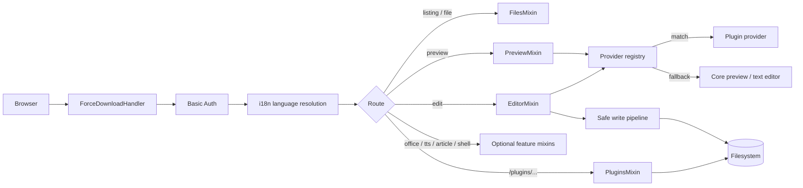
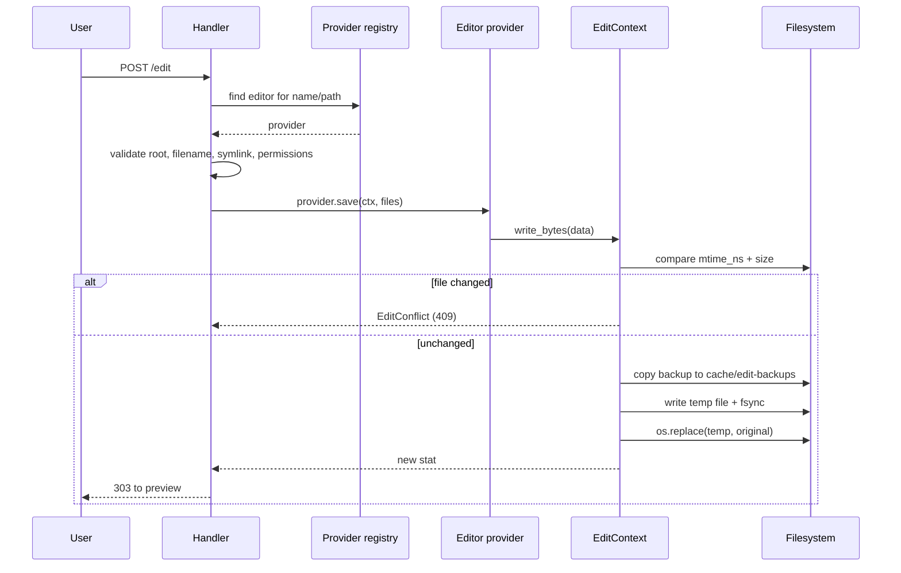

# Architecture

filer is a single-process HTTP file browser. The core is standard-library
only. Optional tools and plugins extend behavior without becoming required
for browsing.

## Request flow



## Write pipeline

Text editing and plugin editors share one write path. Plugins never receive
raw HTTP handler access for writes.



## Plugin lifecycle

```mermaid
flowchart TD
    S[Startup] --> D[Scan --plugins-dir or plugins/]
    D --> M{plugin.json valid?}
    M -->|no| SKIP[Log and skip plugin]
    M -->|yes| V{api_version == 1 and enabled?}
    V -->|no| SKIP
    V -->|yes| I[Add plugin dir and vendor/ to sys.path]
    I --> IMP[Import entry module]
    IMP --> REG[Call register(ctx)]
    REG --> P1[register_editor]
    REG --> P2[register_preview]
    REG --> P3[register_route]
    REG --> P4[register_static]
    REG --> P5[register_locale]
    P1 --> OK[Plugin loaded]
    P2 --> OK
    P3 --> OK
    P4 --> OK
    P5 --> OK
    IMP -->|exception| SKIP
    SKIP --> CORE[Core continues without plugin]
```

Plugins load once at startup. There is no hot reload and no sandbox.

## Modules

| Module | Responsibility |
| --- | --- |
| `config.py` | Shared constants, preview type map, text edit allowlist, edit limits. |
| `auth.py` | HTTP Basic authentication. |
| `textenc.py` | Encoding detection, BOM/newline handling, strict text probe, decoding. |
| `paths.py` | Root confinement and filename validation for new code paths. |
| `providers.py` | Provider registry, editor contract, edit context, atomic writes, backups. |
| `editors/text.py` | Built-in text editor provider. |
| `editor.py` | `/edit` GET/POST routing and edit page rendering. |
| `plugins.py` | Manifest validation, plugin loader, plugin context/request/response, static and route serving. |
| `templates.py` | HTML templates, icons, and embedded frontend helpers. |
| `files.py` | Directory listing, upload, delete, file info, and forced downloads. |
| `preview.py` | Preview routing, built-in renderers, provider dispatch, and inline file browsing. |
| `office.py` | Office document text extraction and conversion helpers. |
| `cfb.py` | OLE2 compound document parsing. |
| `shell.py` | Web terminal command execution, PTY handling, and streaming output. |
| `tts.py` | Text-to-speech synthesis and pronunciation dictionary handling. |
| `article.py` | Web article fetching, cleanup, and image proxying. |
| `response.py` | HTTP response helpers. |
| `i18n.py` | Locale loading, negotiation, rendering, validation, and plugin locales. |
| `ui.py` | Shared `BASE_CSS` and font stack. |
| `util.py` | Size and formatting utilities. |
| `handler.py` | Mixin composition for the HTTP request handler. |

## Core vs plugins

The core keeps the following responsibilities because they are security
boundaries:

- authentication and routing;
- path validation against the served root;
- filename and symlink checks;
- read/write permission checks;
- request size limits;
- atomic replacement and permission preservation;
- backups and stale-write rejection;
- HTTP response headers and i18n rendering.

Plugins provide format-specific behavior:

- detect and parse a file format;
- render preview or editor HTML;
- produce the bytes to save;
- declare optional dependencies in their own directory;
- register namespaced routes and static assets;
- register namespaced locale strings.

The built-in text editor is implemented as a normal editor provider. It is
the reference implementation for the plugin API, even though it ships in the
core and is enabled by default.

## Editing design

- `EditorProvider.matches(name, path)` decides whether a provider handles a
  file.
- `EditorProvider.can_edit(path)` is consulted before showing edit actions
  and again before saving.
- `EditorProvider.render(ctx)` returns an `EditorPage` containing a body
  fragment and optional head HTML.
- `EditorProvider.save(ctx, files)` writes through `ctx.write_bytes()` and
  returns `SaveResult` or `None`.
- Provider priority is descending. Plugins can override the built-in text
  editor with a higher priority.

The text provider preserves the detected encoding, BOM, and newline style.
When a user selects a different encoding, the file is written in that
encoding. Saves are limited to `2 MiB` for text. Requests are limited to
`16 MiB`.

## Plugin design

- Plugins live in one or more `--plugins-dir` directories. The default is
  `<repo>/plugins/`.
- Each plugin directory needs a `plugin.json` manifest and a Python entry
  file.
- `api_version` is a hard compatibility gate. This release supports version
  `1`.
- Route paths must start with `/plugins/<id>/`.
- Static prefixes must start with `/plugins/<id>/` and point inside the
  plugin directory.
- Locale keys are merged under `plugin.<id>.*`.
- A plugin that fails to load is logged and skipped. The core still starts.
- `requires` in `plugin.json` is declarative and informational in this
  release; the loader does not install packages or enforce package versions.
  Vendor plugin dependencies inside the plugin directory or install them in
  the service environment.

See [docs/plugins.md](docs/plugins.md), [docs/plugin-api.md](docs/plugin-api.md),
and [docs/writing-a-plugin.md](docs/writing-a-plugin.md).

## Encoding design

The project does not depend on `chardet` or another third-party detector.
Detection is deterministic and cheap:

1. Check byte-order marks first (UTF-8, UTF-16, UTF-32).
2. Use a null-byte heuristic for UTF-16 without a BOM; reject binary data that
   contains null bytes.
3. Try strict decoding in a fixed order: UTF-8, GB18030, Big5, Shift_JIS.
4. If decoding fails only at the end of the buffer, keep the candidate.
5. Let the user override the detected encoding in the preview and editor.
6. For editing, additionally reject NUL bytes and a high control-character
   ratio before treating an unknown extension as text.

This keeps behavior predictable across machines and avoids shipping a large
detection dependency.

## Development commands

```bash
python3 -m compileall -q .
python3 -B -m unittest discover -s tests -v
python3 -B -m dls.i18n check
```
