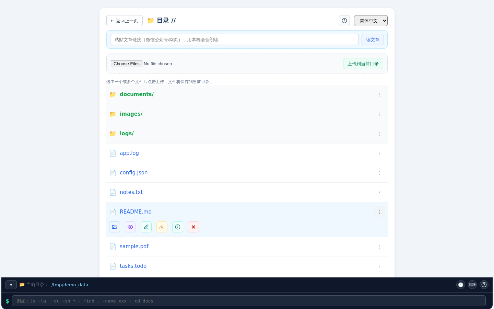
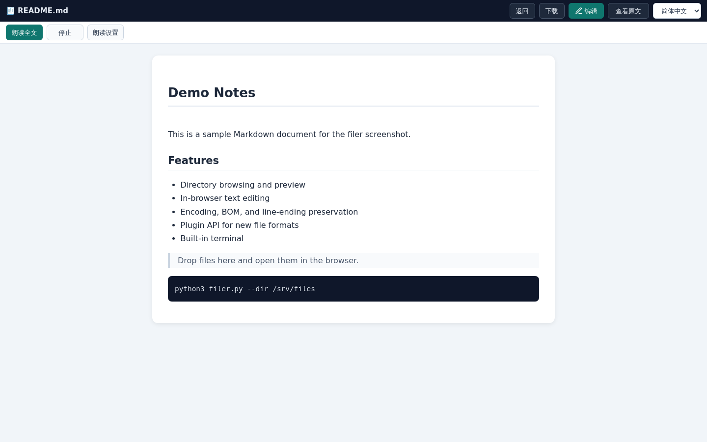
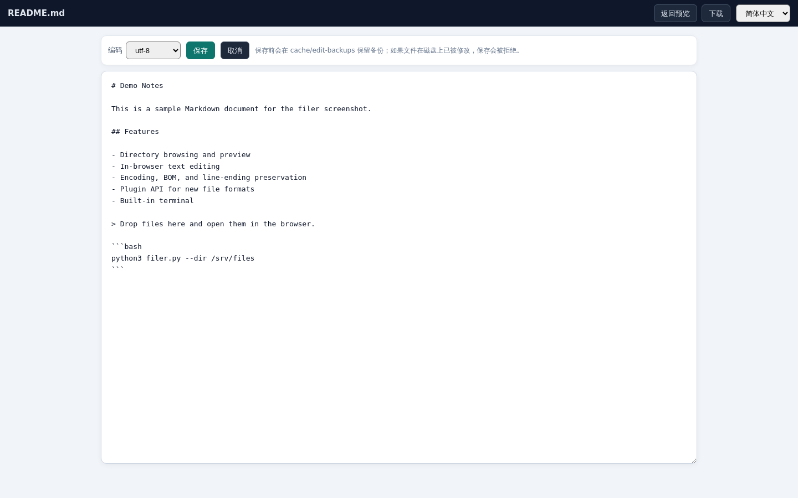
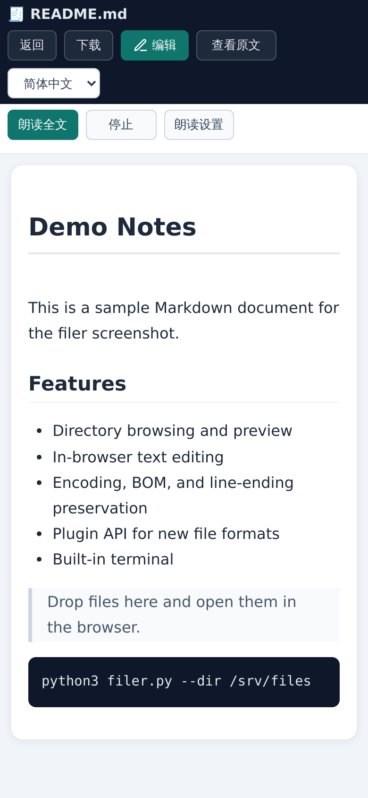
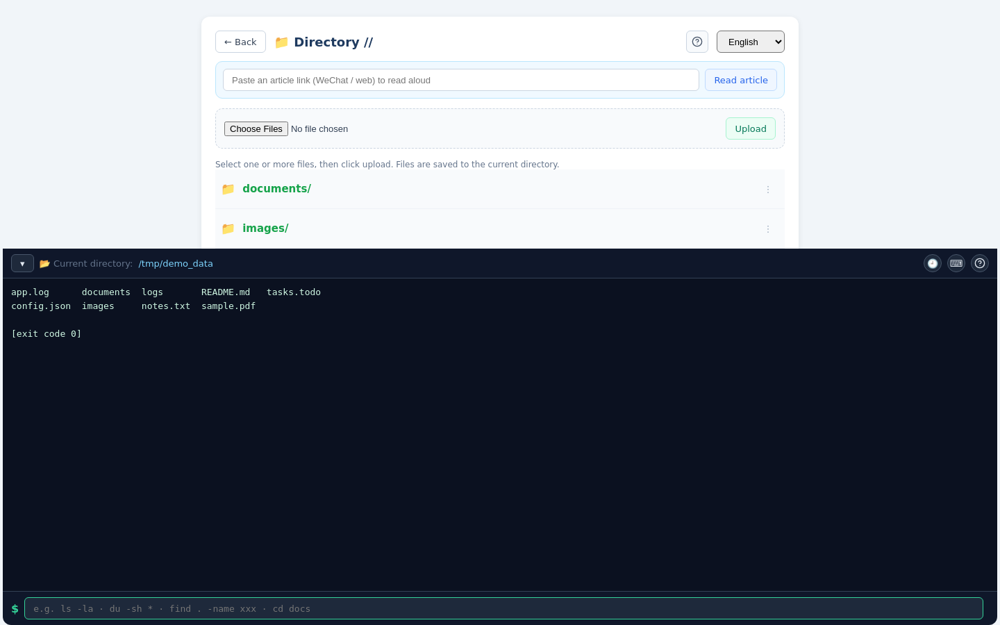

# filer

[](https://github.com/Cheng-Ethan/Filer/actions/workflows/tests.yml)
[](https://github.com/Cheng-Ethan/Filer/releases)
[](LICENSE)

A zero-dependency, self-hosted file browser with built-in preview, text
editing, and a terminal. The core is a single Python process built only on
the standard library: no pip install, no frontend build step, no Docker.



## Why this exists

Sometimes you only need to look at or fix a file on a server, but the
available tools assume you want a full remote session. Opening an SSH
connection to run `cat` or `vim`, remembering an exact path, and scrolling
through terminal output is much more work than the task deserves.

filer is intentionally constrained. The core uses only the Python standard
library: no Flask, no FastAPI, no Node.js build, and no container runtime.
Clone the repository, start the process, and browse the files you already
have.

## Features

### Core

- Directory browsing with type-aware icons.
- Upload, download, and delete files or directories.
- In-browser preview for Markdown, images, PDF, Office documents, and plain
  text.
- In-browser editing for plain text, Markdown, source code, configuration
  files, and other text formats detected by content.
- Text editing preserves the detected encoding, BOM, and line-ending style,
  writes atomically, keeps backups, and rejects stale saves.
- Automatic text encoding detection for UTF-8, GBK, Big5, Shift_JIS, and
  UTF-16/UTF-32.
- Built-in terminal with PTY-backed streaming output.
- A small plugin API for custom preview providers, editors, routes, static
  assets, and plugin locales.

### Optional

- Text-to-speech reading with Edge-TTS; no API key required.
- Web article fetching and reading, including proxied images.
- Office preview through LibreOffice and poppler.
- Office editing through third-party plugins (not included in this release).

## Screenshots

### Document preview



### Text editing



### Mobile layout



### Built-in terminal



## Quick Start

```bash
git clone https://github.com/Cheng-Ethan/Filer.git filer
cd filer
export FILER_AUTH='yourname:yourpassword'
python3 filer.py --dir /your/path
```

`FILER_AUTH` uses the `username:password` format; `DL_AUTH` is accepted as a
fallback, and `--user` can be used instead.

Open <http://127.0.0.1:9000> in your browser.

## Requirements

- Python 3.10+ (developed and tested on Python 3.10).
- No third-party Python packages are required for core browsing, preview, or
  text editing.
- Optional features need LibreOffice, poppler-utils, Edge-TTS, or PDF.js; see
  [Optional Dependencies](#optional-dependencies).
- Plugins may declare their own optional Python dependencies. They are not
  installed or bundled by the core.

## Editing

Text editing is enabled by default. The built-in editor handles:

- `.txt`, `.log`, `.md`, `.markdown`, `.csv`, `.tsv`
- `.json`, `.xml`, `.yaml`, `.yml`, `.toml`, `.ini`, `.conf`, `.cfg`,
  `.properties`, `.env`
- common source and script extensions such as `.py`, `.js`, `.ts`, `.css`,
  `.sh`, `.sql`, `.c`, `.h`, `.cpp`, `.go`, `.rs`, `.java`, `.php`
- common extensionless files such as `Makefile`, `Dockerfile`, `.gitignore`,
  and `.bashrc`

Unknown extensions are editable only when the content passes a conservative
text check: no NUL bytes, a low control-character ratio, and a successful
decode with the detected encoding. Known binary formats such as images,
archives, PDFs, and Office documents are never treated as text.

Current limits and safety behavior:

- Maximum editable text file size: `2 MiB`.
- Maximum edit request body: `16 MiB`.
- Saves are atomic and preserve file permissions.
- A backup is written under `cache/edit-backups/` before each save.
- A save is rejected with `409` if the file changed on disk after the editor
  was opened.
- Symbolic links are not editable.

See [docs/editing.md](docs/editing.md) for the full behavior.

## Plugins

Plugins are trusted Python code loaded at startup from `plugins/` by default.
They can register:

- preview providers
- editor providers
- namespaced HTTP routes under `/plugins/<id>/...`
- static assets
- locale packs under the `plugin.<id>.*` namespace

The core keeps path validation, authentication, atomic writes, backups, and
conflict detection. A plugin only supplies format-specific parsing, rendering,
and the bytes to write.

The repository includes a working example plugin:

- [`examples/plugins/todo-editor`](examples/plugins/todo-editor) edits `.todo`
  files as a checkbox list and demonstrates the editor API.

Office editing is intentionally **not implemented in this release**. The
plugin API is designed so a third-party plugin can add `.xlsx` or `.docx`
editing later. See [docs/writing-a-plugin.md](docs/writing-a-plugin.md) for a
concrete design and implementation guide.

## Documentation

- [ARCHITECTURE.md](ARCHITECTURE.md) — module map, request flow, write
  pipeline, and plugin lifecycle.
- [docs/editing.md](docs/editing.md) — text editing behavior, encoding,
  backups, conflicts, and limits.
- [docs/plugins.md](docs/plugins.md) — plugin overview, installation, trust
  model, and status.
- [docs/plugin-api.md](docs/plugin-api.md) — manifest schema, provider API,
  routes, static assets, locales, and versioning.
- [docs/writing-a-plugin.md](docs/writing-a-plugin.md) — tutorial and Office
  editor design guidance.
- [docs/http-api.md](docs/http-api.md) — HTTP routes, parameters, and
  responses.
- [docs/configuration.md](docs/configuration.md) — CLI options, environment
  variables, plugin directories, and precedence.
- [docs/security-model.md](docs/security-model.md) — threat model, shell
  access, SSRF, plugins, editing, and deployment checklist.
- [docs/development.md](docs/development.md) — local setup, tests, caches, and
  extension points.
- [docs/deployment.md](docs/deployment.md) — systemd, nginx, and Caddy.
- [docs/i18n.md](docs/i18n.md) — locales, plugin translations, and adding a
  language.
- [SECURITY.md](SECURITY.md) — vulnerability reporting and security
  boundaries.
- [CONTRIBUTING.md](CONTRIBUTING.md) — issues, tests, translations, plugins,
  and code style.
- [CHANGELOG.md](CHANGELOG.md) — release history.
- [THIRD_PARTY_NOTICES.md](THIRD_PARTY_NOTICES.md) — optional third-party
  dependencies and licenses.

## Security

> **Important: read this before exposing the service.**

- HTTP Basic Auth is used. Credentials are transmitted in clear text unless
  the connection is protected by TLS.
- The server binds to `127.0.0.1` by default and is only reachable from the
  local machine.
- If you expose it to a network, put it behind an HTTPS reverse proxy such as
  nginx or Caddy.
- There is currently no multi-user support, no rate limiting, and no audit
  log.
- Plugins are trusted code. They run in the server process with the service
  account's permissions. There is no sandbox. Only install plugins you trust.
- Text editing can overwrite files. Keep backups and do not give untrusted
  users access to the service.

See [docs/security-model.md](docs/security-model.md) for the complete model.

## Optional Dependencies

- **LibreOffice (`soffice`)** enables preview for `.doc`, `.xlsx`, `.pptx`,
  and `.rtf` files. If it is missing, the server falls back to text extraction
  where possible; otherwise the preview may be limited, but the service keeps
  working.
- **poppler-utils (`pdfinfo`, `pdftoppm`)** enables PDF page inspection and
  image fallback rendering. If it is missing, PDFs still open with the
  browser's native viewer or fall back to text extraction.
- **edge-tts** enables text-to-speech. If it is missing, the TTS endpoints
  report that the feature is unavailable and the rest of the application
  continues to work.
- **PDF.js (`static/pdfjs/`)** enables the PDF.js viewer for converted Office
  files. If it is missing, the application falls back to page images or the
  browser's native PDF viewer.

Plugins may require additional packages (for example `openpyxl` or
`python-docx`). Those dependencies belong to the plugin and are not installed
by filer.

## Deployment

See [docs/deployment.md](docs/deployment.md) for a systemd unit and
reverse-proxy examples.

## Roadmap

- Office editing plugins (`.xlsx` first, then `.docx`).
- Additional plugin extension points such as list actions and hooks.
- Multi-user support and permissions.
- Audit logging.
- Multi-server management.

## Support

If this project saves you time, please star the repository and report bugs
through GitHub issues. Security issues should follow [SECURITY.md](SECURITY.md).

## License

MIT. See [LICENSE](LICENSE).
