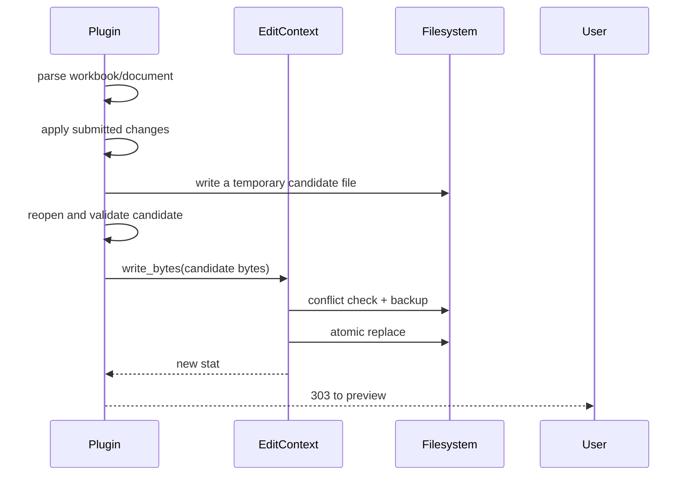

# Writing a Plugin

This tutorial starts with a minimal editor plugin, then explains how to build
an Office document editor as a third-party plugin. The full API reference is
in [plugin-api.md](plugin-api.md).

## Before you start

- Read [plugins.md](plugins.md) and [security-model.md](security-model.md).
- Plugins are trusted Python code. They run in the server process.
- Keep dependencies inside the plugin or install them in the service
  environment. Do not add them to the core.
- Use the core write APIs so you get path confinement, conflict detection,
  backups, atomic writes, and permission preservation.

## 1. Minimal editor plugin

Create a directory:

```text
plugins/hello-editor/
  plugin.json
  plugin.py
  locales/
    en.json
    zh-CN.json
```

`plugin.json`:

```json
{
  "id": "hello-editor",
  "name": "Hello editor",
  "version": "0.1.0",
  "api_version": 1,
  "entry": "plugin.py",
  "enabled": true
}
```

`plugin.py`:

```python
import html
import os

from dls.providers import EditError, EditorPage, EditorProvider


class HelloEditor(EditorProvider):
    id = "hello"
    priority = 100

    def matches(self, name, path):
        return os.path.splitext(name)[1].lower() == ".hello"

    def can_edit(self, path):
        return not os.path.islink(path) and os.access(path, os.W_OK)

    def render(self, ctx):
        raw = ctx.read_bytes(1024 * 1024 + 1)
        if len(raw) > 1024 * 1024:
            raise EditError("edit.too_large", status=413)
        text = raw.decode("utf-8", "replace")
        st = os.stat(ctx.path)
        body = (
            '<form method="post" action="/edit">'
            '<input type="hidden" name="dir" value="%s">'
            '<input type="hidden" name="name" value="%s">'
            '<input type="hidden" name="mtime_ns" value="%d">'
            '<input type="hidden" name="size" value="%d">'
            '<textarea name="text">%s</textarea>'
            '<button type="submit">Save</button>'
            '</form>'
        ) % (
            html.escape(ctx.target, quote=True),
            html.escape(ctx.name, quote=True),
            st.st_mtime_ns,
            st.st_size,
            html.escape(text, quote=False),
        )
        return EditorPage(body=body)

    def save(self, ctx, files=None):
        text = ctx.form.get("text", "")
        ctx.write_bytes(text.encode("utf-8"))
        return None


def register(ctx):
    ctx.register_editor(HelloEditor())
```

Start filer:

```bash
python3 filer.py --dir /tmp/files --plugins-dir plugins
```

Create `/tmp/files/demo.hello`, open it in the browser, and use the edit
action. The save goes through the core and creates a backup.

## 2. Add translations

`plugins/hello-editor/locales/en.json`:

```json
{
  "title": "Hello editor",
  "save": "Save"
}
```

`plugins/hello-editor/locales/zh-CN.json`:

```json
{
  "title": "Hello 编辑器",
  "save": "保存"
}
```

Register the directory:

```python
def register(ctx):
    ctx.register_editor(HelloEditor())
    ctx.register_locale(os.path.join(ctx.dir, "locales"))
```

Use `ctx.t("plugin.hello-editor.save")` in the editor body.

## 3. Add a preview provider

A preview provider returns a complete HTML page:

```python
from dls.providers import PreviewProvider


class HelloPreview(PreviewProvider):
    id = "hello-preview"
    priority = 100

    def matches(self, name, path):
        return name.endswith(".hello")

    def render(self, ctx):
        text = ctx.read_bytes(1024 * 1024).decode("utf-8", "replace")
        return (
            "<!DOCTYPE html><html><head><meta charset=\"utf-8\">"
            "<title>%s</title></head><body><pre>%s</pre></body></html>"
        ) % (html.escape(ctx.name), html.escape(text, quote=False))


def register(ctx):
    ctx.register_editor(HelloEditor())
    ctx.register_preview(HelloPreview())
    ctx.register_locale(os.path.join(ctx.dir, "locales"))
```

Preview providers are checked before the built-in renderer.

## 4. Add a route and static assets

```python
import os
from dls.plugins import PluginResponse


def status(request):
    return PluginResponse(
        body=b'{"ok": true}',
        content_type="application/json; charset=utf-8",
    )


def register(ctx):
    ctx.register_route("GET", "/plugins/hello-editor/status", status)
    ctx.register_static(
        "/plugins/hello-editor/static",
        os.path.join(ctx.dir, "static"),
    )
```

Routes require Basic Auth and are namespaced under `/plugins/<id>/`.

## Office editing design

Office editing is **not implemented in this release**. It should be built as
a plugin under:

```text
examples/plugins/office-editor/
  plugin.json
  plugin.py
  requirements.txt
  vendor/              # optional private dependencies
  static/
  locales/
```

### Excel `.xlsx`

Recommended dependency: `openpyxl` (MIT).

```bash
python3 -m pip install --target examples/plugins/office-editor/vendor \
  openpyxl
```

`plugin.json`:

```json
{
  "id": "office-editor",
  "name": "Office editor",
  "version": "0.1.0",
  "api_version": 1,
  "entry": "plugin.py",
  "requires": {
    "python": ">=3.10",
    "packages": ["openpyxl>=3.1"]
  }
}
```

The loader adds the plugin directory and `vendor/` to `sys.path`, so the
plugin can import its private `openpyxl` copy.

Suggested implementation:

1. `matches` recognizes `.xlsx` (and optionally `.xlsm`).
2. `can_edit` checks size, writability, and rejects symlinks.
3. `render` loads the workbook with `openpyxl`, reads the used range, and
   renders a sheet selector and an HTML grid of cell inputs. Cap the number
   of rows, columns, and cells.
4. Include `mtime_ns` and `size` hidden fields.
5. `save` loads the workbook again, applies submitted cell values, saves to a
   temporary file, then uses `ctx.write_bytes()` with the file bytes. Reopen
   the result to verify it is valid before replacing the original.
6. On validation failure, raise `EditError` and leave the original untouched.

Limitations to document:

- `.xls` is not supported by `openpyxl`.
- Macros in `.xlsm` may need `keep_vba=True`; not all features survive.
- Charts, embedded objects, external links, and some formatting may be lost
  or changed.
- Very large sheets need pagination or cell-count limits.
- A backup does not guarantee perfect fidelity. Recommend external backups.

### Word `.docx`

Recommended dependency: `python-docx` (MIT).

Suggested implementation:

1. `matches` recognizes `.docx`.
2. `render` reads paragraphs and table cells and renders a block editor.
3. `save` updates text while preserving paragraph-level styles where
   possible, saves to a temporary file, verifies it can be reopened, and
   writes through `ctx.write_bytes()`.
4. Document that the first version is a **text-level editor**, not a
   WYSIWYG Word replacement.

Limitations to document:

- `.doc` old binary format is not supported by `python-docx`.
- Inline run formatting may be simplified when text is replaced.
- Tracked changes, comments, fields, content controls, macros, digital
  signatures, and embedded objects may be lost or altered.
- Complex layouts may not round-trip perfectly.
- Keep backups and verify the saved file in a real Word-compatible viewer.

### Save sequence



The plugin should never call `open()` directly to replace the target file.
Use `ctx.write_bytes()` so the core can enforce safety.

## Limits and safety checklist

- Set a maximum file size for your format.
- Limit rows, columns, cells, paragraphs, or rendered HTML size.
- Reject symbolic links.
- Include `mtime_ns` and `size` hidden fields.
- Validate after writing; restore the original on failure.
- Never write outside the path supplied in `ctx.path`.
- Do not execute macros or external programs from untrusted documents.
- Document data-loss risks in the plugin README.

## Testing

Add tests that cover:

- provider matching and priority;
- `can_edit` for writable, read-only, oversized, and symlink files;
- successful save;
- stale `mtime_ns` conflict (`409`);
- invalid form input;
- plugin load failure isolation;
- route and static asset behavior;
- Office round-trip with small fixture files;
- reopening the saved file with the same library.

Run:

```bash
python3 -m compileall -q .
python3 -B -m unittest discover -s tests -v
python3 -B -m dls.i18n check
```

## Distribution

- Ship a folder with `plugin.json`, the entry file, optional `locales/`,
  `static/`, `requirements.txt`, and `vendor/`.
- Do not commit large third-party packages unless the plugin's license and
  repository policy allow it.
- Document installation, dependencies, supported formats, and limitations.
- Add the plugin's dependency licenses to the plugin's own notices. Do not
  add plugin-only dependencies to the core `THIRD_PARTY_NOTICES.md` unless
  they become part of the core distribution.
